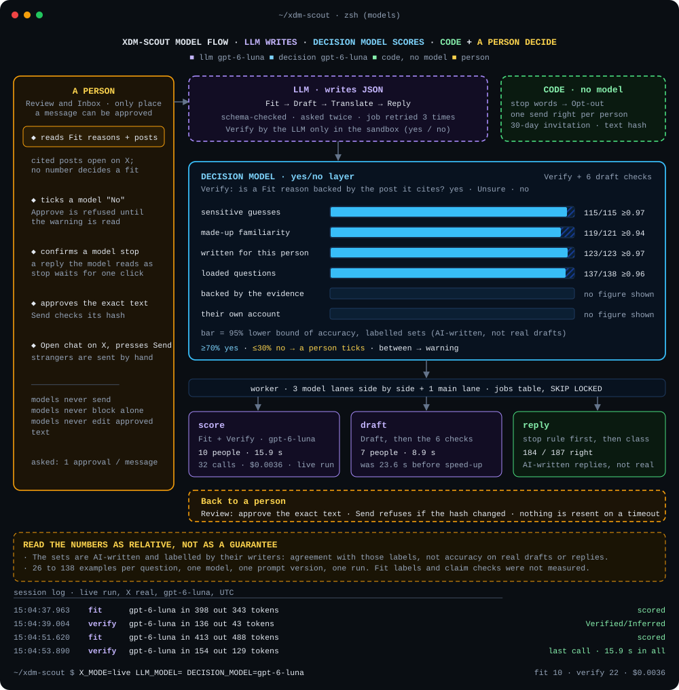

# Models

`LLM_MODEL` runs Fit, Verify, Draft, Translate and Reply; `DECISION_MODEL` answers yes/no checks with a probability. Both default to `gpt-6-luna` in live mode. Answers are JSON checked against a schema; an unparsable answer is asked again, and a failed job is retried up to 3 times. Text from X is quoted data, never instructions.

| Call | Input | Output |
| --- | --- | --- |
| Fit | Bio, profile location, the account the bio names, up to 15 posts, fund criteria | Role, areas, Fit label, reasons with evidence ids, one opening, each criterion |
| Verify | One claim and the excerpts it cites | Probability (yes/no from the LLM without a decision model) |
| Draft | Opening post, verified reasons, sender profile, reviewer note | Up to 4 sentences, each with its source |
| Translate | Draft sentences and a language | The same sentences translated |
| Decide | The draft, or one sentence with its evidence | Probability of yes |
| Reply | The reply text | One of six classes and a probability |

## Fit

One question: is this a person working on AI or robotics whom a venture studio could reach out to? The model picks Strong, Possible, Weak or Not a fit. Strong and Possible need their own product, company or research; agencies, employees of large companies or public bodies, investors and commentators are Weak at most. There is no numeric score. Checked on 24 real accounts from two searches (20 Nov, bio only, labelled by the developer): Strong or Possible was right for 12 of 13, against 13 of 19 before the rule. [Labels](labels.md#fit)

Fund criteria are met, not met or unknown. Met and not met need evidence that passes Verify. Location and funding are never guessed; a profile or company location counts as evidence. Within one Fit label, people who meet more criteria are listed and drafted first; not met puts them last.

## Evidence

Reasons cite `bio:`, `location:`, `company:` or `post:` ids. A reason citing nothing stored is Inferred without a model call. Otherwise the decision model bands the answer: 70% or more Verified (Backed by evidence), 30% or less Inferred (Our guess), in between Unsure (Check the post). Only Verified reasons go to Draft.

## Draft and checks

Draft writes at most 4 sentences and ~450 characters; code adds the greeting. A sentence with no source is flagged.

**Rule checks** decide. Stop: a personal claim with no post behind it, an offer not in the sender profile, no line that lets them say no, claimed familiarity. Warn: a link, over 450 characters, more than one question, near-duplicate of another draft, an opening over 30 days old.

**Model checks** advise: 70% or more is Yes, 30% or less No, in between a warning. A No must be ticked before Approve; a model never blocks a send alone.

| Question | Asked on |
| --- | --- |
| No sensitive guesses | the draft |
| No made-up familiarity | the draft and its evidence |
| Written for this person | the draft |
| No loaded questions | the draft and its evidence |
| Backed by the evidence | each claim with the post it cites |
| Looks like their own account | name, handle, followers, bio |

## Replies

A rule catches stop requests first. The LLM then picks Interested, Question, Not now, Not interested, Opt-out or Unclear, with a probability; below 0.70 the reply is Unclear.

Measured on 300 labelled replies (`gpt-6-luna`, 18 Nov 2026):

| Method | Tune (164) | Report (136) |
| --- | --- | --- |
| LLM, cut 0.70 (the app) | 146 (89.0%) | 122 (89.7%) |
| LLM, best cut on tune (0.80) | 147 (89.6%) | 123 (90.4%) |
| Decision model confirms the LLM class | 134 to 144 (82 to 88%) | |
| One decision question per class | 130 (79%) | |

The best cut gains one reply per half, within run-to-run noise, so the app keeps 0.70. Decision-model variants did worse because yes/no questions cannot carry the rules that order the classes.

## How far to trust the numbers

- The labelled sets are AI-written; results show agreement with those labels, not accuracy on real messages.
- 26 to 300 examples per question; the figure shows 95% lower bounds.
- One model, one prompt version; answers vary between runs.
- Fit labels were not measured against labelled accounts.
- Reply rate and targeting quality need a pilot with real users.

Scripts: [Evaluation](eval.md).
